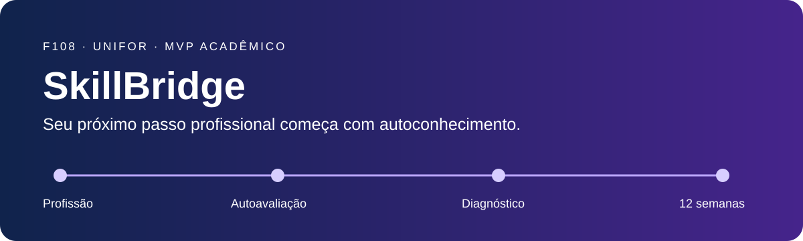
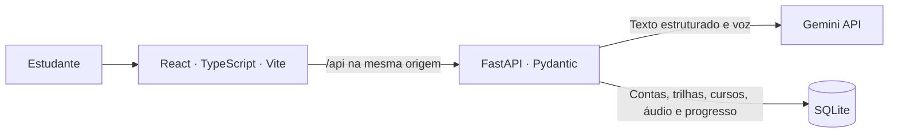
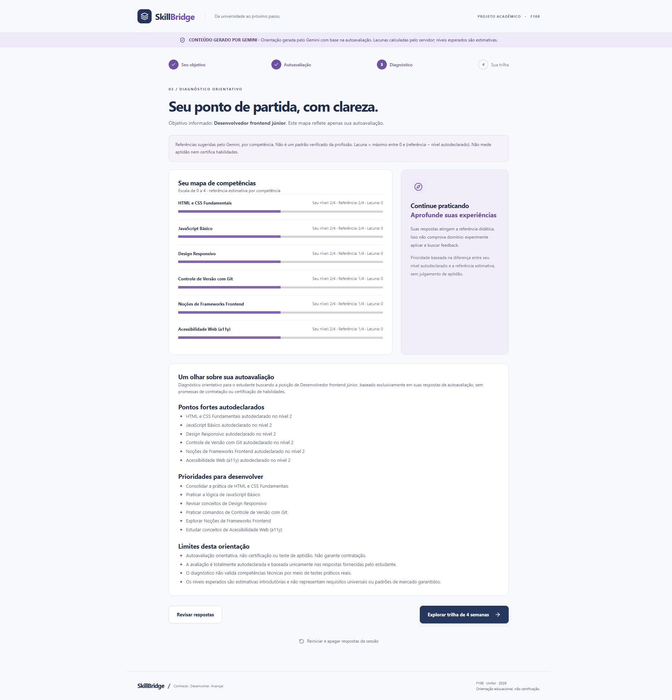

<p align="center"></p>

<p align="center"><em>Ilustração editorial do projeto.</em></p>

# SkillBridge V3

[](https://react.dev/)
[](https://www.typescriptlang.org/)
[](https://fastapi.tiangolo.com/)
[](https://www.sqlite.org/)
[](#status)

O SkillBridge ajuda universitários que buscam seu primeiro estágio ou emprego em tecnologia a escolher o que estudar. A V3 usa uma autoavaliação para orientar o diagnóstico e transforma uma trilha de **12 semanas** em um curso personalizado com prática, áudio e acompanhamento de progresso.

**[Repositório da V3](https://github.com/PedroGiffoni/skillbridgev3)** · **[Saúde da API de testes](https://skillbridge-v3-api-pedrogiffoni.onrender.com/health)** · **[Plano da V3](docs/SKILLBRIDGE_V3_PLANO_MESTRE.md)** · **[Documentação F108/Unifor](docs/09-relatorio-f108.md)**

## Sumário

[Funcionalidades](#funcionalidades) · [Materiais por tema](#materiais-por-tema) · [Arquitetura](#arquitetura) · [Execução local](#execução-local) · [Testes](#testes) · [Publicação](#publicação) · [Status](#status) · [Histórico do projeto](#histórico-do-projeto)

## Funcionalidades

| Etapa | O que a V3 oferece |
| --- | --- |
| 🎯 Carreira e autoavaliação | 72 carreiras de tecnologia em 12 áreas, oito perguntas de competência geradas pelo Gemini com escala de 0 a 4 e 12 perguntas de contexto opcionais. |
| 🗓️ Diagnóstico e trilha | Lacunas calculadas a partir da autoavaliação e plano de 12 semanas ajustado ao contexto e à disponibilidade. O histórico de quatro semanas permanece legível. |
| 📚 Curso e microlições | O Gemini prepara uma estrutura personalizada de quatro módulos. A biblioteca privada permite gerar e reabrir microlições sob demanda, praticar com dicas e retomar tentativas. |
| ✅ Avaliação de módulo | Prova de dez questões, com correção no servidor. A aprovação exige **pelo menos 80% e um acerto em cada competência do módulo**. A reprovação indica lições de reforço. A aprovação libera os módulos seguintes conforme os pré-requisitos. |
| 📊 Painel de aprendizagem | Progresso semanal, mapa de competências, tempo de estudo registrado pelo aluno, XP, conquistas e retomada. O replanejamento preserva semanas concluídas. |
| 🛠️ Qualidade | Relatos categorizados por lição e painel agregado de qualidade para contas verificadas autorizadas. |
| ♿ Interface | Layout responsivo, modo claro e escuro, navegação por teclado e suporte à preferência de movimento reduzido. |

O diagnóstico é orientação educacional. O login por Google ou código de e-mail associa resultados ao perfil privado. O histórico, os cursos e as atividades salvas podem ser reabertos sem gerar o conteúdo de novo. [Trilha e migração](docs/31-v3-trilha-12-semanas.md) · [Biblioteca e microlições](docs/34-v3-biblioteca-microlicoes.md) · [Provas, painéis e qualidade](docs/37-v3-dominio-dashboards-release.md)

## Materiais por tema

| Formato | Experiência |
| --- | --- |
| 🎬 Videoaula | Slides com exemplos, diagramas e transcrição. Com a narração gerada, os slides avançam junto ao áudio. |
| 🎧 Audiolivro | Capítulo dividido em seções, com texto e narração sob demanda. |
| 🎙️ Podcast | Conversa entre dois apresentadores sintéticos, com transcrição por locutor. |
| 🧠 Mapa mental | Tópico central com ramos que podem ser expandidos por toque ou teclado. |
| 💡 Quiz | Três questões de revisão com feedback por resposta. |
| 📝 Simulado | Questões de aplicação, com nota e feedback ao enviar todas as respostas. |

A preparação dos seis formatos usa o modelo de texto. A síntese de voz é solicitada separadamente e usa Gemini TTS. Os áudios ficam no SQLite, vinculados à revisão da lição. [Guia de materiais](docs/36-v3-materiais-por-tema.md) · [Ensaio com texto e voz na cota gratuita](docs/38-v3-ensaio-gratuito-piloto.md)

## Arquitetura



| Camada | Stack |
| --- | --- |
| Interface | React 19, TypeScript, Vite, Tailwind CSS, Motion e Three.js. |
| API | Python 3.13, FastAPI e Pydantic. |
| IA | SDK oficial `google-genai`, validação da saída e filas de geração. |
| Persistência | SQLite com migrações aditivas para preservar os registros existentes. |
| Testes | pytest, Vitest, Testing Library, ESLint e build TypeScript. |

O catálogo compartilhado está em `frontend/src/careers.json`. O backend precisa do checkout integral para importá-lo. Os contratos da API e a configuração ficam no [README do backend](backend/README.md).

## Execução local

Instale Python 3.13, Node.js 22.12+ e Git. No Windows, abra o PowerShell.

```powershell
git clone https://github.com/PedroGiffoni/skillbridgev3.git
cd skillbridgev3
```

### Terminal 1 — backend e login de teste

A partir da raiz do clone, crie o ambiente Python e o arquivo de configuração local.

```powershell
cd backend
python -m venv .venv
.\.venv\Scripts\python.exe -m pip install -r requirements.txt
if (!(Test-Path .env)) { Copy-Item .env.example .env }
```

Edite `backend/.env` antes de testar a geração. A chave única autentica texto e voz. Confirme os modelos e a cota gratuita do seu projeto no Google AI Studio antes de marcar as opções de confirmação. [Chaves da API](https://aistudio.google.com/apikey) · [Limites ativos](https://aistudio.google.com/rate-limit)

| Variável | Valor ou finalidade |
| --- | --- |
| `GEMINI_API_KEY` | Chave privada do projeto, usada apenas no backend. |
| `GEMINI_MODEL` | Identificador do modelo de texto. O ensaio usou `gemini-3.5-flash-lite`. |
| `GEMINI_FREE_TIER_CONFIRMED` | `true` após confirmar a cota de texto. |
| `GEMINI_TTS_MODEL` | Identificador opcional do modelo de voz. O ensaio usou `gemini-3.8-flash-lite-tts`. |
| `GEMINI_TTS_FREE_TIER_CONFIRMED` | `true` após confirmar a cota de voz. |
| `STUDY_PLAN_V3_ENABLED` | `true` mantém a geração de 12 semanas. |

O `.env` é ignorado pelo Git. Guarde a chave nele e reinicie a API sempre que editar a configuração. O arquivo [backend/.env.example](backend/.env.example) tem os nomes e padrões das demais variáveis.

```powershell
.\.venv\Scripts\python.exe dev_login.py
```

O servidor de teste abre em `127.0.0.1:8000` e usa um SQLite separado em `backend/data/login-local/`. Para usar provedores reais no ambiente local, configure Google ou e-mail no backend e inicie com `.\.venv\Scripts\python.exe -m uvicorn app.main:app --host 127.0.0.1 --port 8000 --no-access-log` no lugar do lançador de teste. [Guia de login e histórico](docs/30-login-historico-perfil.md)

### Terminal 2 — frontend

Em outro terminal, a partir da raiz do clone, rode o frontend.

```powershell
cd frontend
npm.cmd ci
npm.cmd run dev -- --port 5173 --strictPort
```

Abra a interface com os dois terminais ativos. [SkillBridge local](http://localhost:5173) · [Saúde da API](http://127.0.0.1:8000/health) · [OpenAPI](http://127.0.0.1:8000/docs)

### Testar a experiência

1. Escolha uma carreira e inicie uma nova autoavaliação. Use dados sintéticos. Quando a tela pedir login, use `aluno@example.test`. Clique em **Receber código por e-mail** e consulte `backend/data/login-local/codigo.txt`.
2. No diagnóstico, siga **Explorar trilha de 12 semanas → Abrir curso da trilha → Preparar plano do curso → Salvar na biblioteca**.
3. Abra uma lição, selecione **Preparar esta lição** e entre em **Materiais do tema → Preparar materiais**. No **Podcast**, autorize a síntese e selecione **Gerar podcast com duas vozes**.
4. Em **Meus cursos**, abra **Avaliações de módulo** para testar a prova. Em **Meu desenvolvimento**, confira o progresso e a retomada.

## Testes

Execute cada bloco a partir da raiz, após instalar as dependências.

```powershell
cd backend
.\.venv\Scripts\python.exe -B -m pytest -p no:cacheprovider -q
```

```powershell
cd frontend
npm.cmd run test
npm.cmd run lint
npm.cmd run build
```

A verificação local da V3 registrou **144 testes do backend e 48 do frontend aprovados**, com lint e build concluídos. A suíte usa serviços simulados. O ensaio separado usou o Gemini real com perfis sintéticos e verificou a geração do curso, do podcast de duas vozes, de narrações e dos demais materiais. [Registro do ensaio](docs/38-v3-ensaio-gratuito-piloto.md)

## Publicação

O ambiente de testes usa serviços dedicados ligados à `main` deste repositório.

| Serviço | Configuração |
| --- | --- |
| **Render Free** | Serviço web Python com checkout integral do repositório e Python 3.13. Build `cd backend && pip install -r requirements.txt`. Start `cd backend && sh start.sh`. Verificação em `/health`. |
| **Vercel Hobby** | Preset Vite, raiz `frontend`, build `npm run build` e saída `dist`. O arquivo `frontend/vercel.json` encaminha `/api/*` à API de testes no Render. |

No Render, mantenha `AUTH_COOKIE_SECURE=true` e coloque o domínio HTTPS da Vercel em `CORS_ORIGINS` como lista JSON. A geração exige as variáveis Gemini no backend. Para validar remotamente a área privada, configure `AUTH_OTP_SECRET` e um provedor de entrada. No Google, cadastre a origem HTTPS da interface no cliente OAuth e informe `AUTH_GOOGLE_CLIENT_ID` no Render. [Configuração de login](docs/30-login-historico-perfil.md)

Verifique `/health` no Render e `/api/config` pelo domínio da Vercel. A verificação completa inclui diagnóstico, login, reabertura da trilha, geração de lição e reprodução de áudio. O SQLite no Render Free é efêmero, então use dados sintéticos no ambiente publicado e faça a validação com persistência em um banco local dedicado. [Limites do Render Free](https://render.com/docs/free#local-files-lost-on-redeploy) · [Protocolo de piloto](docs/38-v3-ensaio-gratuito-piloto.md#hospedagem-e-decisão-de-piloto)

## Status

| Item | Situação |
| --- | --- |
| V3 local | Fluxo com dados sintéticos validado com texto e voz do Gemini na cota gratuita. |
| V3 hospedada | API disponível no Render Free. Publicação da interface em preparação. Validação de ponta a ponta depende de credenciais Gemini e Google no backend. |
| Persistência hospedada | SQLite efêmero no Render Free. Contas reais exigem armazenamento durável e restauração de backup verificada. |
| Piloto F108/Unifor | Pesquisa com participantes e relatório final pendentes. [Protocolo e critérios](docs/07-metricas-validacao.md) · [Relatório](docs/09-relatorio-f108.md) |

A avaliação considera apenas o que o estudante declarou. Use dados pedagógicos sintéticos e confira materiais e gabaritos gerados antes de utilizá-los no piloto. Os dados enviados ao Gemini seguem as condições do provedor. [Condições da API Gemini](https://ai.google.dev/gemini-api/terms)

## Histórico do projeto

- **V1 acadêmica.** Publicação inicial com diagnóstico e trilha de quatro semanas. [Registro da publicação](docs/15-publicacao.md)
- **V2.** Catálogo de carreiras, login, perfil e histórico privado. [Versões e configuração de login](docs/30-login-historico-perfil.md)
- **V3.** Trilha de 12 semanas, biblioteca, microlições, materiais multimodais e painéis. As migrações mantêm legíveis os registros anteriores, e a revisão de planos preserva o progresso existente. [Auditoria](docs/AUDITORIA_V3.md) · [Persistência](docs/32-v3-persistencia-catalogo.md) · [Sprints](docs/08-sprints-kanban.md)

<details>
<summary>Capturas reais da V1 e documentação histórica</summary>

Capturas da V1 publicada em novembro de 2026, obtidas com dados sintéticos.

| Diagnóstico orientativo | Trilha original de quatro semanas |
| --- | --- |
| [](docs/assets/gemini-diagnostico-real.jpg) | [](docs/assets/gemini-trilha-real.jpg) |

[Questionário contextualizado](docs/17-questionario-aprofundado.md) · [Temas e movimento](docs/21-temas-movimento.md) · [Personagens 3D](docs/23-personagens-3d.md) · [Resiliência do Gemini](docs/28-resiliencia-gemini.md) · [Decisões registradas](docs/decisoes.md)

</details>
