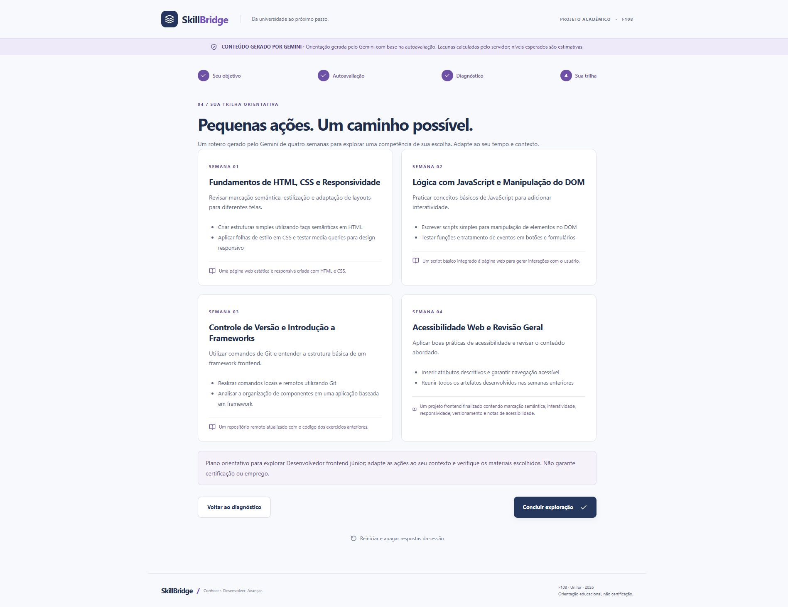
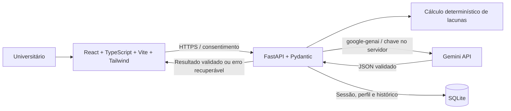
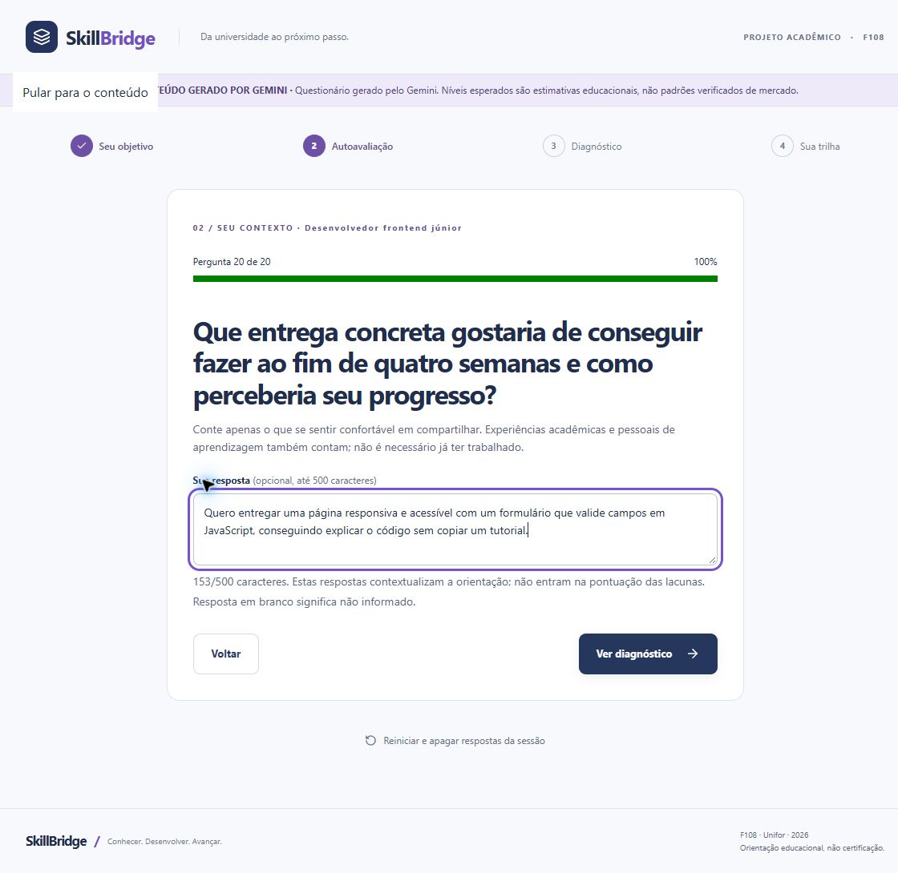
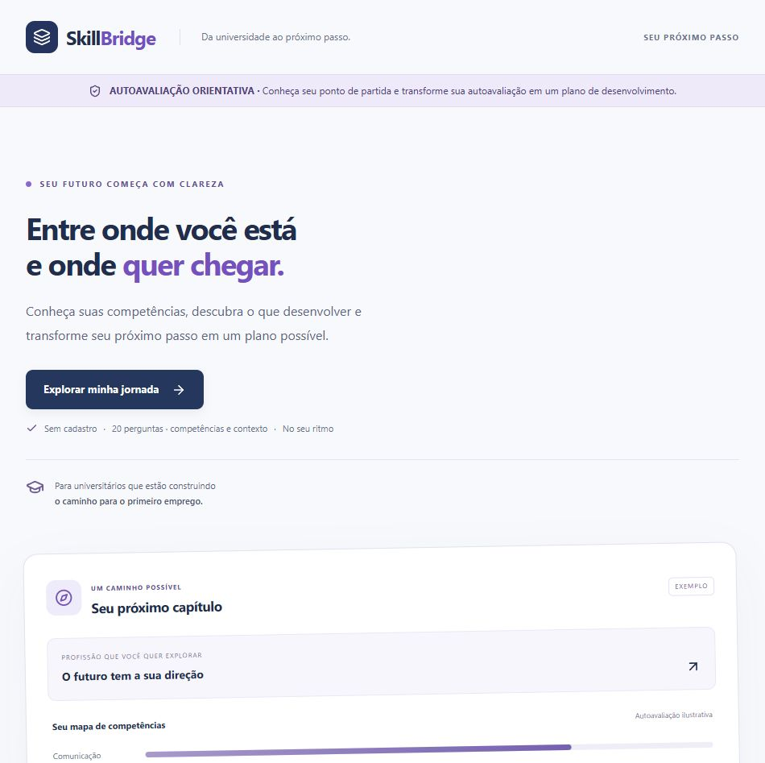
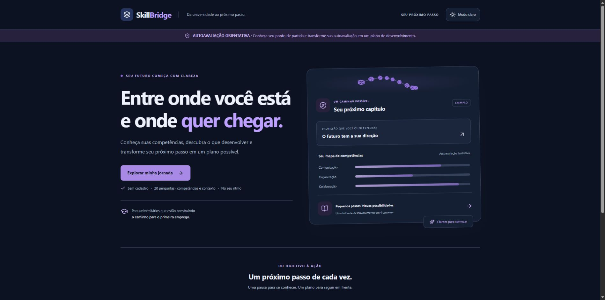
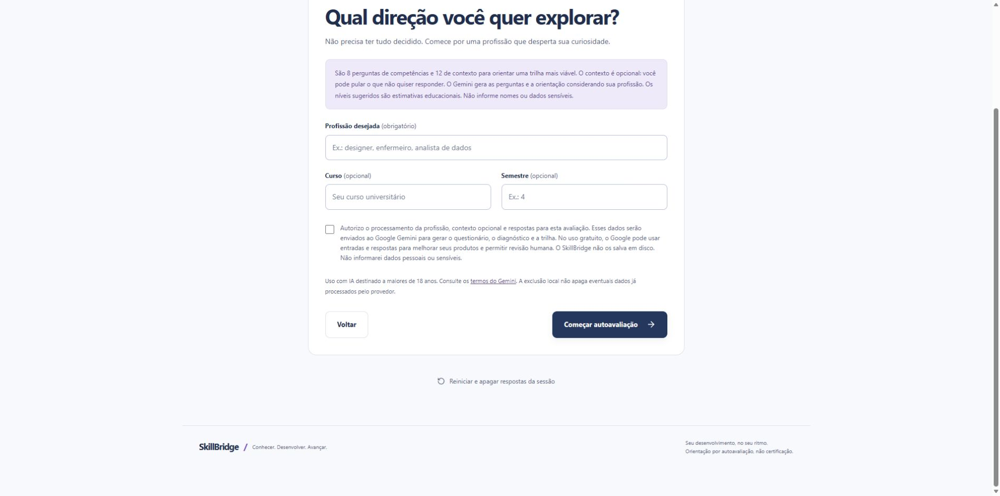

<p align="center"></p>

<p align="center"><em>Ilustração editorial do projeto; não é uma captura da aplicação.</em></p>

# SkillBridge

[](https://react.dev/)
[](https://www.typescriptlang.org/)
[](https://fastapi.tiangolo.com/)
[](docs/08-sprints-kanban.md)

> Orientação de competências para universitários que buscam o primeiro estágio ou emprego em tecnologia. A autoavaliação orienta um diagnóstico e uma trilha de estudos. Na branch `V3`, novos diagnósticos geram 12 semanas por padrão e o histórico anterior conserva as quatro semanas registradas.

**[🌐 Aplicação principal](https://skillbridge-two-rosy.vercel.app)** · **[🩺 API principal](https://skillbridge-api-pedrogiffoni.onrender.com/health)** · **[V2 de testes](https://skillbridge-v2-login.vercel.app)** · **[📋 Documentação acadêmica](docs/09-relatorio-f108.md)**

## Sumário

[Proposta e recursos](#proposta-e-recursos) · [Arquitetura](#arquitetura) · [Execução local](#executar-localmente) · [Teste de login](#testar-o-login-local) · [Gemini](#ativar-gemini) · [Privacidade](#comportamento-e-privacidade) · [Testes](#verificar) · [Estrutura](#estrutura-e-situação) · [Publicação](#publicação-render--vercel) · [Login e histórico](#login-e-histórico)

## Proposta e recursos

| Etapa | O que a aplicação oferece |
| --- | --- |
| 🎯 Carreiras de tecnologia | 72 opções em 12 áreas, com seleção por clique e busca por nomes, siglas e sinônimos |
| 🧭 Questionário | 8 perguntas geradas pelo Gemini e 12 perguntas de contexto opcionais, todas por alternativas |
| 📊 Autoavaliação | Escala de 0–4 e cálculo determinístico das lacunas |
| 🗓️ Trilha | Diagnóstico orientativo e plano de 12 semanas na V3, com leitura do histórico de quatro semanas |
| 🤖 IA obrigatória | Questionário, diagnóstico e trilha dependem do Gemini; falhas permitem nova tentativa |
| 🎧 Materiais por tema | Videoaula com slides narrados, audiolivro, podcast de duas vozes, mapa mental, quiz e simulado na V3 local. [Guia e configuração](docs/36-v3-materiais-por-tema.md) |
| 🎓 Progresso de aprendizagem | Avaliação de domínio, reforço, desbloqueio de módulos, painel do aluno, tempo de estudo e XP na V3 local. [Domínio, painéis e verificação](docs/37-v3-dominio-dashboards-release.md) · [Ensaio real na cota gratuita](docs/38-v3-ensaio-gratuito-piloto.md) |
| 🌗 Aparência | Tema claro/escuro no topo, preferência local e animações com Three.js + Motion |
| ♿ Interface | Layout responsivo, rótulos e suporte a movimento reduzido; auditoria completa ainda pendente |

## Login e histórico

A autoavaliação fica aberta. Ao concluir, o estudante entra com Google ou código por e-mail para receber o diagnóstico e guardá-lo na conta gratuita. A área privada reúne **Meu histórico** e **Meu perfil**, com foto e informações opcionais. O histórico usa SQLite e pode ser reaberto sem chamar o Gemini novamente.

Para iniciar a autoavaliação, escolha uma carreira por área ou digite para ver sugestões. O backend valida a opção escolhida antes de chamar o Gemini. [Catálogo e critérios da V2](docs/02-requisitos.md#catálogo-de-carreiras-na-v2)

Para habilitar a entrada, configure Google ou um transporte de e-mail compatível com a hospedagem. A aplicação principal usa os serviços vinculados à `main`. A `developer-login` serve o ambiente de testes com interface e API próprias. [Guia de login, histórico e perfil](docs/30-login-historico-perfil.md)

## Capturas reais

Capturas da V1 publicada em 11/11/2026, com respostas sintéticas e geração pelo Gemini.

| Diagnóstico orientativo | Trilha de quatro semanas |
| --- | --- |
| [](docs/assets/gemini-diagnostico-real.jpg) | [](docs/assets/gemini-trilha-real.jpg) |

## Arquitetura



| Camada | Tecnologia / hospedagem |
| --- | --- |
| Interface | React 19, TypeScript, Vite 7, Tailwind 4, Three.js 0.187 e Motion 14 / Vercel |
| API | Python 3.13, FastAPI, Pydantic / Render Free |
| IA | SDK oficial `google-genai`; modelo configurável por ambiente |
| Estado da branch de login | Rascunho temporário no navegador, sessão e histórico privado em SQLite |
| Qualidade | pytest, Vitest, Testing Library, ESLint e build TypeScript |


O MVP acadêmico F108/Unifor tem entrega em 27/11/2026. Os registros da publicação Render/Vercel descrevem a V1. A pesquisa com usuários reais permanece pendente.

## Executar localmente

Use Python 3.13 e Node 22.12+ com npm. Abra a pasta do projeto no VS Code e crie dois terminais PowerShell a partir da raiz.

**Terminal 1 — API**

```powershell
cd backend
python -m venv .venv
.\.venv\Scripts\python.exe -m pip install -r requirements.txt
# Execute apenas se .env ainda não existir; não sobrescreva sua chave:
if (!(Test-Path .env)) { Copy-Item .env.example .env }
.\.venv\Scripts\python.exe -m uvicorn app.main:app --host 127.0.0.1 --port 8000 --no-access-log
```

**Terminal 2 — interface**

```powershell
cd frontend
npm.cmd ci
npm.cmd run dev -- --port 5173 --strictPort
```

Abra o [SkillBridge local](http://localhost:5173). O Vite encaminha `/api` ao FastAPI na porta 8000. Pressione **Ctrl+C** para parar cada servidor. [Saúde da API](http://127.0.0.1:8000/health) · [OpenAPI](http://127.0.0.1:8000/docs)

### Testar o login local

Se nenhum método real estiver configurado, rode o servidor de teste abaixo **no lugar do Uvicorn do primeiro terminal**, a partir da pasta `backend`. Mantenha o segundo terminal rodando.

```powershell
.\.venv\Scripts\python.exe dev_login.py
```

1. Abra a página inicial e escolha **Minhas avaliações** para testar só o login. Para testar a avaliação completa, inicie um novo questionário com o Gemini configurado.
2. Use o endereço de teste `aluno@example.test` e clique em **Receber código por e-mail**.
3. No terminal ou no editor do VS Code, leia `backend/data/login-local/codigo.txt`. Cole o código na tela e confirme. Por padrão, ele expira em 10 minutos e só pode ser usado uma vez.

Esse servidor escuta apenas em `127.0.0.1` e grava o código em arquivo, com chave e banco próprios em uma pasta ignorada pelo Git. Ao trocar do servidor normal para esse modo, comece uma avaliação nova, pois os questionários anteriores usam outra chave de assinatura. Para receber e-mail real ou usar Google, siga o [guia de login](docs/30-login-historico-perfil.md).

## Ativar Gemini

Edite somente backend/.env. Não compartilhe a chave, não use VITE_* para segredos, não versione .env. Sua chave existente não será sobrescrita pelos passos acima.

1. Confirme no projeto correto do Google AI Studio o nível Free e os limites ativos do modelo desejado: https://aistudio.google.com/rate-limit?timeRange=last-28-days. O modelo selecionado no Playground não comprova cota gratuita da API.
2. Preencha GEMINI_API_KEY e GEMINI_MODEL com o identificador exato confirmado. O código não fixa um modelo padrão; a configuração atual verificada usa `gemini-3.5-flash-lite`.
3. Somente depois de verificar a cota, altere GEMINI_FREE_TIER_CONFIRMED=true. Essa variável registra confirmação do operador; não verifica cobrança automaticamente. Não vincule faturamento para este MVP sem aprovação.
4. Reinicie a API depois de alterar .env (Ctrl+C e comando uvicorn novamente).

GET /api/config informa apenas gemini_enabled, sem revelar chave ou modelo. Se faltar configuração/confirmação, a API retorna 503 e não chama Google. Não há opção de demonstração sem IA; configure o backend para iniciar uma avaliação. Em 11/11/2026, a cota gratuita do projeto SKILLBRIDGE foi conferida e o modelo `gemini-3.5-flash-lite` passou no teste real local. Chave configurada exclusivamente no Render e fluxo real online verificado. [Registro de ativação](docs/16-ativacao-gemini.md).

Variáveis: GEMINI_TIMEOUT_SECONDS (1–60, padrão 30), GEMINI_MAX_REQUESTS_PER_MINUTE (1–60, padrão conservador local de 5 gerações, cada uma com até duas tentativas; não é cota Google), CORS_ORIGINS (lista JSON de origens permitidas). A chave jamais deve ir para frontend/.env.

## Comportamento e privacidade

Carreira e consentimento → 8 perguntas de competências (escala 0–4) → 12 perguntas de contexto opcionais → entrada gratuita → diagnóstico e trilha de estudos. O backend calcula a lacuna com `max(0, esperado - autodeclarado)`. As escolhas de contexto ajudam a ajustar a trilha, mantendo o cálculo baseado nos níveis autodeclarados.

O Gemini gera o questionário e, depois da entrada, o diagnóstico e a trilha. Cada geração pode ser repetida uma vez automaticamente para falhas temporárias 500/502/503/504, dentro do prazo configurado. Cota, prazo esgotado ou saída inválida exibem erro e permitem nova tentativa manual.

Resultados são orientação educacional por autoavaliação, não certificação, teste de aptidão ou promessa de emprego. IA pode errar; revise recomendações. Não são gerados resultados sem IA. Se o diagnóstico falhar, o formulário conserva níveis e alternativas de prática e contexto, e permite tentar novamente com o mesmo questionário enquanto seu token for válido.

As 12 respostas contextuais só são enviadas com o diagnóstico; pular não dispara chamadas extras. O navegador mantém um rascunho temporário da avaliação durante a entrada. O token do questionário protege a integridade das perguntas por uma hora. Com a chave estável configurada no backend, o token mantém sua validade após reiniciar a API. O resultado gerado fica no histórico privado da conta. Veja [o contrato e a recuperação da trilha V3](docs/31-v3-trilha-12-semanas.md). O [guia de login](docs/30-login-historico-perfil.md) descreve os dados armazenados. A V3 usa o mesmo SQLite para [revisões privadas de plano e curso](docs/32-v3-persistencia-catalogo.md). A geração de blueprint usa Gemini e uma fila persistente. [Contrato do Sprint 3](docs/33-v3-blueprint-gemini.md). A área Meus cursos reabre versões salvas e prepara lições com consentimento. [Biblioteca V3](docs/34-v3-biblioteca-microlicoes.md). O player oferece três formatos de exercício, corrige no servidor e recupera o progresso salvo ao reabrir a lição. [Prática e progresso da V3](docs/35-v3-player-pratica.md)

Com IA ativa, profissão, contexto acadêmico opcional, alternativas de contexto e prática e níveis autodeclarados são enviados ao Google. Não informe dados pessoais, confidenciais ou sensíveis. No serviço gratuito, entradas/saídas podem ser usadas para melhoria e revisão humana, conforme https://ai.google.dev/gemini-api/terms. A exclusão local não apaga dados já processados pelo provedor. Uso com IA destinado a adultos; pesquisa real deve recrutar participantes maiores de 18 anos. O protótipo não coleta feedback de pesquisa.

## Verificar

```powershell
cd backend
.\.venv\Scripts\python.exe -m pytest -q
.\.venv\Scripts\python.exe -m pip check
```

```powershell
cd frontend
npm test
npm run lint
npm run build
```

Testes usam mocks, sem consumir Gemini ou depender de chave. Os testes backend usam Settings sem .env para impedir chamadas reais. O teste real local executou duas chamadas Gemini com dados sintéticos: questionário e diagnóstico HTTP 200, seis competências e quatro semanas. Evidências em [ativação Gemini](docs/16-ativacao-gemini.md). A suíte com mocks continua independente de rede e segredo.

## Estrutura e situação

- backend/app: configurações, schemas, tokens, cálculo, adaptador Gemini e endpoints; dados genéricos antigos permanecem apenas como fixtures de testes offline.
- backend/tests: contratos, segurança de entrada, cálculo e falhas com mocks.
- frontend/src: fluxo, cliente API validado e erros com nova tentativa; fixtures sintéticas importadas somente por testes.
- docs/13-integracao-gemini.md: alterações, rastreabilidade, testes e pendências desta rodada.
- docs/08-sprints-kanban.md e docs/09-relatorio-f108.md: registros acadêmicos e planejamento.

Fases 2/3 implementadas; Gemini real verificado localmente. Fase 4: publicação de demonstração verificada, Gemini hospedado ativado e fluxo real online verificado. Equipe, brainstorming, ≥10 participantes reais, ≥5 evidências e relatório final permanecem pendentes.

## Publicação Render + Vercel
A configuração abaixo registra a publicação inicial da V1. A versão integrada da `main` conserva a URL original e encaminha `/api/*` ao Render principal. O serviço principal mantém sua própria configuração do Gemini. [Configuração da versão integrada](docs/30-login-historico-perfil.md#aplicação-principal)

Configuração e evidências em docs/15-publicacao.md. Backend da V3: mantenha o checkout integral e execute os comandos na pasta backend. Use Python 3.13.5, build cd backend && pip install -r requirements.txt, start cd backend && sh start.sh e health /health. O catálogo compartilhado vive em frontend/src/careers.json. Frontend: raiz frontend, Vite, npm run build, dist. Configure VITE_API_BASE_URL na Vercel com a origem HTTPS efetiva do Render e CORS_ORIGINS no backend com a origem efetiva do frontend. Nenhuma chave no frontend. Após mudar VITE_API_BASE_URL, faça novo build/deploy. Sem URL configurada em produção, a interface informa indisponibilidade. Publicação inicialmente demonstrativa; Gemini ativado e verificado em 11/11/2026.

## Aplicação publicada — 11/11/2026
Frontend: https://skillbridge-two-rosy.vercel.app
Backend/saúde: https://skillbridge-api-pedrogiffoni.onrender.com/health
Ambos publicados e fluxo completo de demonstração verificado. Use o domínio estável do frontend acima (CORS autorizado). Gemini real local aprovado com modelo/cota confirmados; na publicação, a chave está configurada somente no backend Render e o fluxo real foi verificado. Evidências, versões e limites em docs/15-publicacao.md. Render Free pode levar mais tempo após inatividade; se a avaliação expirar após reinício da API, gere outro questionário.

## Status e próximos passos

| Item | Situação |
| --- | --- |
| V1 acadêmica | Interface e API publicadas. Em 19/11, erros 503 do Gemini impediram concluir a avaliação. [Registro do incidente](docs/28-resiliencia-gemini.md) |
| V2 de testes | Ambiente separado. O guia de login registra a configuração necessária para ativar os provedores e o histórico durável. |
| Login no computador | O lançador local permite testar código, sessão e perfil com endereço sintético. |
| Pesquisa com participantes | Não realizada; recrutamento e consentimento pendentes |
| Entrega F108 | Prazo 27/11/2026; relatório final pendente |

<details>
<summary>📚 Documentação e rastreabilidade</summary>

- [Auditoria e backlog](docs/11-auditoria-plano.md)
- [Integração e contratos](docs/13-integracao-gemini.md)
- [Publicação e evidências](docs/15-publicacao.md)
- [Ativação real Gemini](docs/16-ativacao-gemini.md)
- [Decisões](docs/decisoes.md)
- [Sprints e Kanban](docs/08-sprints-kanban.md)
- [Relatório F108](docs/09-relatorio-f108.md)

</details>

### Limitações da V1 publicada

Sem contas, histórico persistente ou acompanhamento de progresso. Render Free pode hibernar e reiniciar, invalidando questionários em andamento. Uma única instância/worker é necessária para os tokens e o limite por processo. Cotas do provedor podem mudar; a confirmação de gratuidade não é um bloqueio automático de cobrança. Links e recomendações gerados precisam de revisão humana. Testes técnicos com dados sintéticos não substituem validação com usuários reais.

### Questionário aprofundado
Atualização de 11/11/2026: oito perguntas práticas de competências e doze de contexto, com exemplos opcionais, navegação e progresso até vinte perguntas. O diagnóstico deve considerar disponibilidade, recursos e objetivo concreto, reconhecendo informação ausente. Não há garantia de melhoria da orientação sem pesquisa real. [Decisões, arquivos e testes](docs/17-questionario-aprofundado.md). As capturas acima documentam a versão anterior, de seis perguntas. O novo fluxo de vinte perguntas foi verificado na aplicação publicada com duas chamadas reais e respostas sintéticas: a trilha considerou a disponibilidade de duas horas semanais e a dificuldade relatada em JavaScript.

[](docs/assets/questionario-20-contexto.jpg)

[Ver diagnóstico contextualizado desta versão](docs/assets/questionario-20-diagnostico.jpg).

### Linguagem da interface
Textos públicos revisados em 11/11/2026: apresentação de produto, sem menções à entrega F108/Unifor, ao protótipo ou a pendências acadêmicas. Privacidade e limites da autoavaliação seguem explícitos. A opção de demonstração foi removida em 18/11/2026. Documentação F108 preservada em docs/. [Registro editorial](docs/18-textos-interface.md).

[](docs/assets/interface-produto-inicio.jpg)

Captura real da apresentação revisada; [tela de conclusão](docs/assets/interface-produto-conclusao.jpg) verificada em demonstração local.

### Apresentação para celular
Versão horizontal 16:9 com 12 slides, animações e navegação por toque. No celular, gire a tela para melhor leitura: [abrir apresentação](https://skillbridge-two-rosy.vercel.app/apresentacao.html). Arquivo estático independente em frontend/public/apresentacao.html, publicado junto ao frontend. [Registro e limites da verificação](docs/19-apresentacao.md).

### Alternativas que respondem à pergunta
Cada pergunta de competência apresenta cinco descrições práticas próprias, geradas junto ao enunciado pelo Gemini e vinculadas à escala de 0 a 4. As alternativas descrevem a experiência do usuário, sem gabarito ou exigência de ensinar outras pessoas. O diagnóstico recebe a descrição escolhida, recuperada do questionário assinado. As alternativas editoriais genéricas antigas permanecem apenas como fixtures de testes offline; não há fluxo demonstrativo disponível na aplicação. [Contrato e verificações](docs/20-alternativas-contextualizadas.md).

Verificado em 17/11/2026 no aplicativo publicado: oito conjuntos de alternativas específicas, seleção preservada ao revisar, diagnóstico Gemini e quatro semanas, com dados sintéticos. [Exemplo real das novas opções](docs/assets/alternativas-contextualizadas-exemplo.jpg). Após a atualização, recarregue a página e gere um novo questionário.

## 🌗 Temas e movimento

Capturas reais da landing publicada em 17/11/2026:

| Claro | Escuro |
| --- | --- |
|  |  |


Use o botão de sol/lua no cabeçalho para alternar a aparência sem perder a avaliação em andamento. No celular, o controle exibe somente o ícone com nome acessível.

- **Motion:** entradas suaves, transições entre etapas e cartões com reação ao ponteiro.
- **Three.js:** caminho abstrato decorativo na prévia inicial; animação de até quatro segundos, resolução limitada e descarte dos recursos ao sair.
- **Acessibilidade:** preferência de movimento reduzido desativa entradas animadas e a cena WebGL; um ornamento estático permanece disponível.
- **Carregamento:** Three.js separado do pacote inicial; o build ainda informa um aviso de tamanho para esse arquivo (~753 kB, ~193 kB gzip).

Implementação e verificações: [registro de temas e movimento](docs/21-temas-movimento.md). Documentação das bibliotecas: [Motion](https://motion.dev/docs/react-accessibility) e [Three.js](https://threejs.org/manual/pages/cleanup.html).

## 🧑‍💼 Personagens 3D

Dois modelos GLB originais, de blazer e de camisa, inspirados nas referências fornecidas. Possuem materiais incorporados, articulações rígidas e quatro animações: acenar, respirar, celebrar e passos no lugar.

**[Abrir estúdio interativo](https://skillbridge-two-rosy.vercel.app/personagens.html)** · [Arquivos e instruções de uso](frontend/public/models/README.md)

| Modelo | GLB | Animações |
| --- | --- | --- |
| Profissional de blazer | [Baixar](frontend/public/models/profissional-blazer.glb) | 4 |
| Profissional de camisa | [Baixar](frontend/public/models/profissional-camisa.glb) | 4 |

Primeira versão para revisão visual, em página independente. Zero erros e zero avisos na validação glTF; articulação animada e restauração da pose verificadas em código. Não possui skinning ou rig facial. [Detalhes e limites](docs/23-personagens-3d.md).


Movimentos revisados na versão 2: curvas contínuas, aceno de braço/punho/cabeça, respiração do tronco e transições graduais entre gestos e ao parar. [Registro da revisão](docs/24-movimentos-fluidos.md).

## 🤖 Avaliação exclusivamente com IA — 18/11/2026

Removidos a opção de demonstração e os resultados genéricos de contingência. Falhas de conexão, timeout, cota e resposta inválida exibem erro e permitem nova tentativa, preservando as respostas em memória. Os contratos públicos aceitam apenas `source_mode: gemini` e não recebem mais o campo `demo`. Após esta atualização, recarregue a página para usar o cliente novo. [Contrato, arquivos e verificações](docs/27-avaliacao-somente-ia.md).

Publicação verificada: Vercel READY e Render live no commit funcional `21743c1`; perfil e contrato inspecionados, sem chamadas reais Gemini nesta rodada.



### Recuperação de falhas temporárias do Gemini

Em 19/11/2026, foi reproduzido HTTP 503 do Google enquanto outra solicitação gerou oito perguntas com sucesso. O adaptador passa a permitir uma única nova tentativa para erros transitórios, sem ultrapassar o prazo total; erros de acesso/configuração recebem categoria própria. Nenhum resultado é substituído por demonstração. [Diagnóstico, testes e situação da correção](docs/28-resiliencia-gemini.md).

> [!IMPORTANT]
> **Disponibilidade em 19/11/2026:** a melhoria de retentativa está publicada, mas o teste real ainda recebeu 503 do Google nas duas tentativas. Alternativas gratuitas testadas também falharam; modelo, chave e cobrança foram preservados. O fluxo completo continua pendente de recuperação externa. [Evidências e limites](docs/28-resiliencia-gemini.md).
