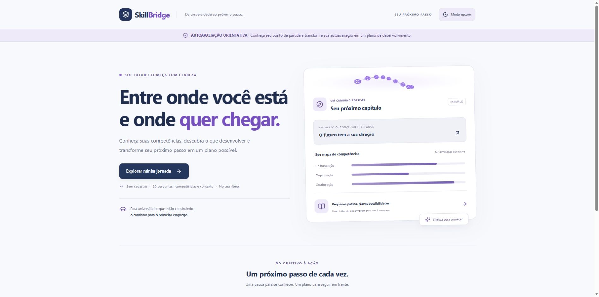
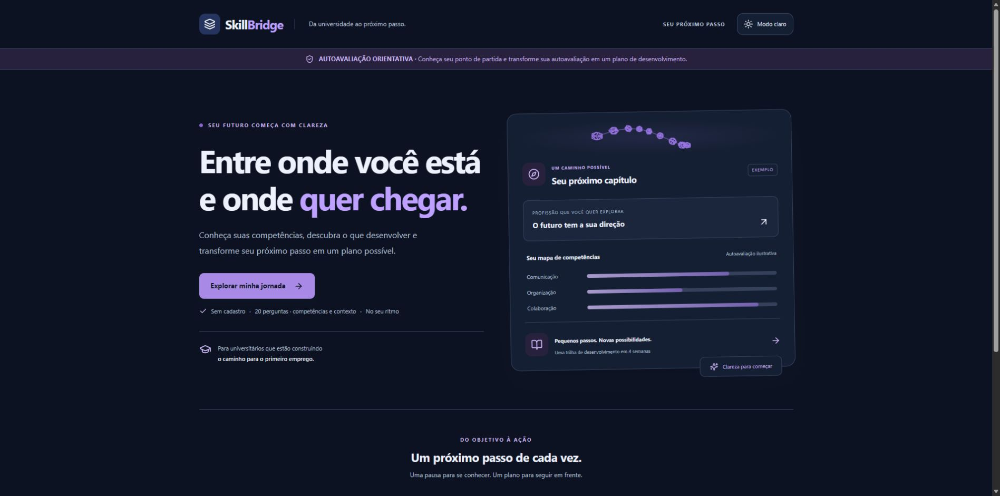

# Temas e movimento — 17/11/2026

Solicitação: botão superior para modo claro/escuro e uso real de Three.js e Motion na aplicação.

## Implementação

- Tokens semânticos de cor em todas as telas; sol/lua acessível no cabeçalho, inclusive a 390px.
- Tema inicial do dispositivo ou preferência `skillbridge-theme` no localStorage; leitura antes do React evita clarão do tema incorreto. Falha do armazenamento não impede a troca.
- Alternar tema não remonta a aplicação nem apaga respostas. Nenhuma resposta é persistida.
- Motion 14.14: entradas da landing, cartões ao entrar na tela/hover e transição discreta de etapas. Movimento reduzido respeitado também no estado inicial.
- Three.js 0.187: cena local decorativa na landing, carregada por import dinâmico quando WebGL2 está disponível e movimento reduzido está desativado. Não usa dados da avaliação. Animação finita de quatro segundos, pausa ao ocultar documento, resolução limitada a 1,5x, geometria/material/renderer liberados ao desmontar. Falha de importação/WebGL mantém ornamento CSS.
- Apresentação `/apresentacao.html` preservada; sem alterações no backend ou chamadas Gemini nesta rodada.

## Verificação

- `cd frontend; npm test`: 17 testes aprovados (4 arquivos), incluindo persistência exclusiva de tema, falha de armazenamento e preservação do formulário; fluxo completo demonstrativo e contratos existentes.
- `npm run lint`: aprovado.
- `npm run build`: aprovado; aviso de chunk Three.js ~753 kB (~193 kB gzip), separado do JS inicial ~351 kB (~115 kB gzip). Não é uma medição de desempenho em celular real.
- `npm audit --omit=dev`: zero vulnerabilidades. Instalação reportou 12 alertas incluindo dependências de desenvolvimento; não foi executado upgrade forçado fora do escopo.
- Navegador local: temas claro/escuro, canvas Three.js presente, viewport efetivo de 390px sem rolagem horizontal na landing e primeira pergunta. Demonstração explicitamente identificada; sem consumo Gemini.
- Pesquisa com usuários reais permanece pendente. Verificações técnicas não equivalem a validação com beneficiários.

## Arquivos

`frontend/package.json`, `frontend/package-lock.json`, `frontend/index.html`, `frontend/src/App.tsx`, `frontend/src/styles.css`, `frontend/src/ThemeToggle.tsx`, `frontend/src/JourneyScene.tsx`, `frontend/src/test-setup.ts`, `frontend/src/theme.test.tsx`, README e registros de decisões/sprint.

## Publicação

Commit funcional `7fe98f59a0641232bae54b11bb297087e8ee2b4c`, deploy Vercel `dpl_GYy4weUD75Fwb1XeGZQuGYZvHvyG` READY em produção, alias `skillbridge-two-rosy.vercel.app`. Botão e canvas Three.js conferidos na aplicação publicada, nos dois temas. A apresentação horizontal de 12 slides foi conferida separadamente em `/apresentacao.html`.

Capturas reais da versão publicada (landing ilustrativa, não resultados de participantes):

| Claro | Escuro |
| --- | --- |
|  |  |

O console local registrou mensagens de canal de extensão fechado; não foram tratadas como evidência de ausência de erros de navegador. Não houve teste com participantes nesta rodada.
