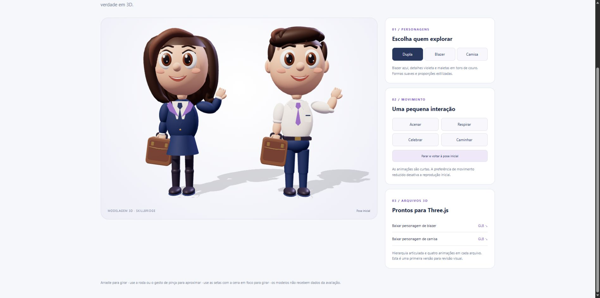

# Personagens 3D - 17/11/2026

## Solicitação e entrega

Produzir dois personagens inspirados nas referências fornecidas, prontos para uso no Three.js. Foram criados modelos procedurais originais com cabeça/olhos estilizados, cabelos castanhos, roupas profissionais, detalhes azul/violeta e maleta. A interpretação não reproduz fielmente o acabamento das imagens.

Entregas: `frontend/public/models/profissional-blazer.glb` (480.988 bytes) e `profissional-camisa.glb` (507.556 bytes). 50.534 e 49.102 triângulos; 85 e 78 malhas. Sem texturas ou recursos externos. Hierarquia rígida articulada, sem skinning ou rig facial. Quatro clips incorporados: Acenar, Respirar, Celebrar, Caminhar (passos no lugar).

## Prévia

Rota independente `/personagens.html` construída como segunda entrada Vite. A aplicação continua em `/` e a apresentação em `/apresentacao.html`. Controles para selecionar a dupla ou um personagem, girar com ponteiro/setas, aproximar, reproduzir e parar. Reprodução finita e movimento reduzido do dispositivo respeitado no início. Renderização sob demanda quando parado; resolução limitada a 1,5x; interrupção ao ocultar página e descarte ao sair. Falha WebGL exibe instrução para baixar os arquivos.

## Verificação

- `node frontend/scripts/create-characters.mjs`: exportação GLB e releitura com GLTFLoader, quatro clips e articulação presentes em cada modelo.
- `node frontend/scripts/validate-characters.mjs`: glTF Validator com zero erros/avisos; 46 e 37 mensagens informativas UNUSED_OBJECT. Teste real em memória do AnimationMixer verifica movimento do braço, restauração da pose e transformações finitas nos quatro clips. Relatório em `models/validation.json`.
- `cd frontend; npm run lint`: aprovado.
- `npm test`: 17 testes aprovados, 4 arquivos. Não equivalem a teste visual do WebGL.
- `npm run build`: aprovado, app e personagens com entradas separadas; aviso existente de chunk Three.js acima de 500 kB. Arquivos 3D não são requisitados pela aplicação principal.
- Navegador local: dois modelos renderizados, controles de animação acionados, pose inicial restaurada, seleção individual e setas de rotação exercitadas; viewport efetivo 390px sem rolagem horizontal.

## Limites e próximo uso

Primeira versão para revisão visual antes de incorporar personagens à jornada. Não foi realizado teste de desempenho em aparelho móvel físico, retargeting humanoide, captura de movimento ou pesquisa com usuários. Necessário avaliar orçamento de renderização (malhas/triângulos) antes de exibir os dois modelos em telas com outros gráficos.

## Arquivos alterados

Frontend: `personagens.html`, `src/characters-studio.ts`, `src/characters-studio.css`, `scripts/create-characters.mjs`, `scripts/validate-characters.mjs`, `public/models/*`, `vite.config.ts`, `eslint.config.js`, `package.json`, `package-lock.json`. Documentação: README, decisões, sprint e este registro. Nenhuma chamada Gemini nesta rodada.

## Publicação

Commit `d832a6fc187323be38d51bfbb9fcbdfba9aa1627`; Vercel `dpl_5res8VnEUSm8ZGFYZdwnGWtHkL2k` READY, alias de produção confirmado. Prévia em https://skillbridge-two-rosy.vercel.app/personagens.html. Dois modelos carregados e botão Acenar/retorno à pose inicial conferidos na publicação. Aplicação principal conferida em `/`; o arquivo da apresentação permaneceu idêntico ao original no build.

Captura real da prévia publicada:

Pacote local para entrega: `output/characters/SkillBridge-personagens-3D.zip`, com dois GLB, README, manifesto, relatório de validação e captura real. `npm audit --omit=dev`: zero vulnerabilidades; continuam os alertas conhecidos em dependências de desenvolvimento. Nenhum teste de usuários reais foi realizado.
