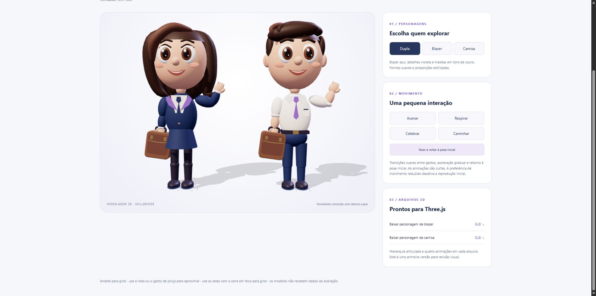

# Revisão de fluidez dos movimentos - 17/11/2026

Pedido: melhorar movimentos percebidos como rígidos. Causas observadas no código: poucas poses lineares, interrupção com stopAllAction na troca e duração fixa de reprodução, independente do clip.

## Alterações

- Curvas analíticas amostradas a 60 Hz, com envelope quintic de aceleração/desaceleração e início/fim na pose de repouso. Não equivale a 60 FPS de renderização.
- Aceno coordenado entre ombro, cotovelo, punho e cabeça. Respiração altera a escala do tronco, sem levantar pés. Celebração substitui saltos lineares por gesto de braço/cabeça. Passos no lugar incluem joelhos, pés e contramovimento dos braços.
- Transições de 450 ms entre ações e retorno de 500 ms ao parar, preservando o peso de ações interrompidas. Clips clonados evitam reinicializar uma ação ainda em fade; ações inativas são liberadas.
- Reprodução acompanha duração real (4,8 / 5 / 4,8 / 5,6 segundos); controle de tempo por delta acumulado. Documento oculto/redução de movimento interrompem imediatamente sem continuar processamento.
- Rig ainda rígido, sem skinning, IK ou captura de movimento. O arquivo muda, não a geometria dos personagens.

## Verificação

`node frontend/scripts/create-characters.mjs` e `node frontend/scripts/validate-characters.mjs`: dois GLB, quatro clips cada, zero erros/avisos glTF. Testes de articulação/restauração, transformações finitas, pose final igual à inicial, arranque com passo angular limitado e respiração sem deslocamento dos pés. Maior passo angular a 60 Hz: 2,884 graus. Valores descrevem continuidade geométrica, não satisfação do usuário.

17 testes frontend, lint e build aprovados. Advertência de tamanho do chunk Three.js permanece. Arquivos atualizados: scripts de geração/validação, dois GLB, manifest/validation, visualizador TS/HTML, README dos modelos e projeto, registros de decisão/sprint e este documento. A aplicação principal e a apresentação não foram alteradas. Nenhuma chamada Gemini ou validação com participantes.

Publicado e verificado: commit 42a2920b918687f1c8945de966ed01c0bc19cefb, Vercel dpl_Gp6oYj7FJJHk4QfPEzZMEa6nbfNC READY. Na prévia publicada foram acionados aceno, respiração e parada; estado de transição e conclusão com retorno suave conferidos. Captura estática não demonstra fluidez temporal; avaliação do acabamento pelo responsável continua necessária.

Pacote ZIP local atualizado com os novos GLB e relatório de validação. Arquivos agora com 858.008 e 884.580 bytes. Geometria e contagem de malhas preservadas.
